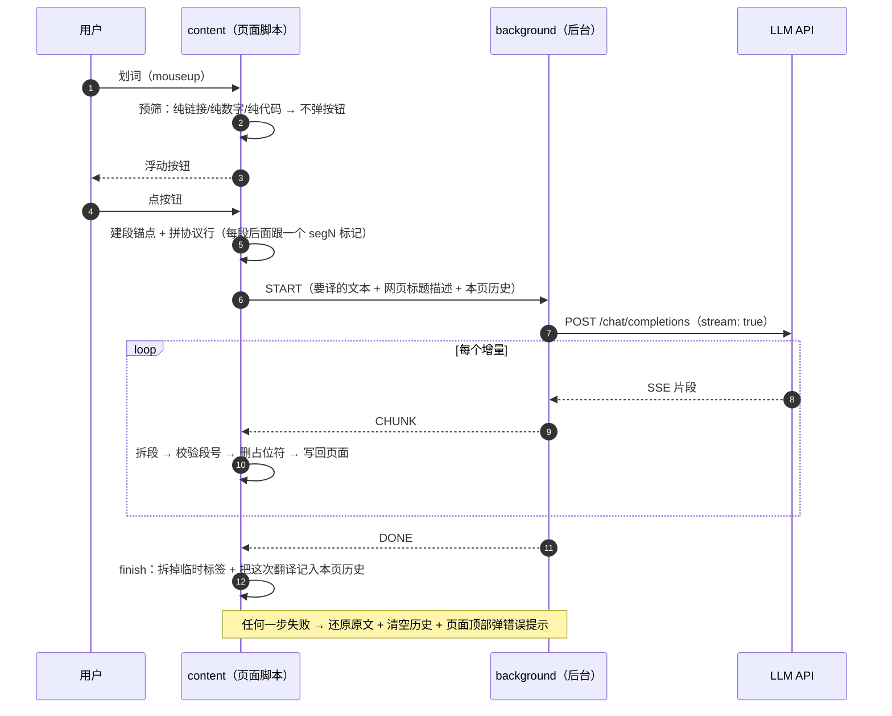
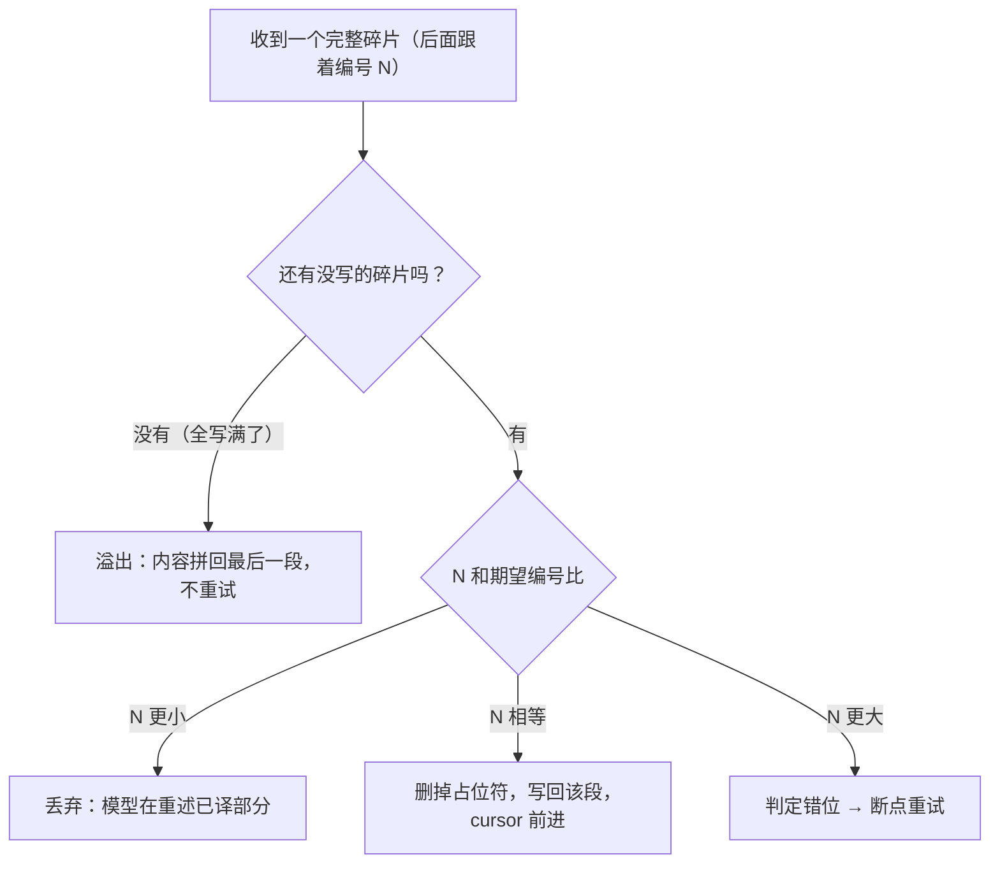

# 架构文档：划词翻译流程

> **怎么用这份文档**：第 1 节看"整体在干什么"（3 分钟），第 2 节按**你的目标**查文件，
> 第 3 节才是细节（只在需要时读对应那一节）。
> **协议改动约定以 `AGENTS.md` 的「最容易踩的坑」为准**，本文只讲代码怎么串起来。
> 改完按 `AGENTS.md` 的顺序跑：`pnpm lint` → `pnpm typecheck` → `pnpm test` → `pnpm build`。

## 1. 概览

### 30 秒版本

```
划词 → 浮动按钮 → 点一下 → 选区文本被切成一堆"碎片" → 发请求给 LLM
     → 译文一边流回来一边原地替换页面文字 → 结束（或出错就还原原文）
```

> 一句话：**把网页上的选中文字切成小碎片，让模型按碎片逐块翻译，再把译文按碎片写回原来的位置。**

### 一图看懂



补充：项目只有三个入口（content / background / options），上面这条链路只涉及前两个。

| 入口 | 文件 | 干什么 |
|---|---|---|
| content | `app/content/index.ts` | 注入网页，管选区、按钮、翻译会话 |
| background | `app/background/index.ts` | 后台常驻，拿着 API Key 调 LLM |
| options | `app/options/index.tsx` | 设置页（baseUrl / model / apiKey / targetLang） |

### 三个必须先记住的设计

1. **碎片编号是地标**
   每个碎片后面跟 `{{segN}}`，N 严格等于"碎片下标 + 1"。
   content 端靠它判断模型有没有多切/少切碎片；一旦对不上，只重译**出错碎片之后**的部分，不重翻全文。

2. **占位符只占位**
   `{{var}}` 的意思是"这里有不译内容"（没选中的文字、`pre/code` 块）。
   写回时**整类删掉**，页面上的未选中部分本来就还在，模型不用管。

3. **本页上下文是"只往后加"的对话**
   同一页面每翻译成功一次，就往本页历史里追加一问一答（`app/content/pageContext.ts`）。
   下次请求把历史接在 system prompt 后面，模型能看到本页此前的译文。
   为让请求前缀**逐字节不变**（供应商的 prompt cache 才能命中），网页标题只在**本页第一次翻译时读一次**，之后永久冻结。

### 术语表（看不懂正文时回来查）

| 词 | 意思 |
|---|---|
| 碎片 / 段 | 一个文本节点（或一整块 `pre/code`）= 一个碎片 = 一个段。**和句子、段落无关** |
| 协议行 | 一个碎片拼出来的那行文本，里面可能有 `{{var}}` 占位符 |
| 协议文本 | 所有协议行用 `{{segN}}` 串起来的整段请求文本 |
| 锚点 | 临时包在选中文字外面的 `<span>`，用来按碎片写译文；结束时会拆掉 |
| preserve 块 | 不翻译的块（`pre`/`code`），整块只占一个碎片，块内 DOM 不动 |
| 错位 | 模型输出的碎片编号和输入对不上（多切、少切、编号跳了） |

## 2. 阅读建议

### 按目标查文件（省时间版）

| 我想…… | 读这个 |
|---|---|
| 改浮动按钮的位置/样式/出现时机 | `content/FloatingButton.ts`、`content/index.ts` |
| 改"什么内容不值得翻"的判定 | `content/selectionFilter.ts`、`utils/textFilter.ts` |
| 改选中的哪些 DOM 被翻、怎么切碎片 | `content/domAnchor.ts`、`content/segmentPlan.ts` |
| 改流式写回、重试、失败处理 | `content/TranslationSession.ts`（**主干**） |
| 改提示词 / 换成别的模型 | `background/prompt.ts`、`background/StreamTranslator.ts` |
| 改上下文（历史怎么攒、什么时候清） | `content/pageContext.ts`、`utils/toast.ts` |
| 改协议标记形态（`{{segN}}` / `{{var}}`） | **只改** `utils/protocol.ts`（见 AGENTS.md 的约定） |

### 理解的顺序（一次只读一层）

1. `content/index.ts` —— 读完你会知道：事件怎么进来的、当前会话存在哪。
2. `content/TranslationSession.ts` —— 读完你会知道：一次翻译从发请求到收尾的完整剧本。
3. `content/InlineTranslator.ts` —— 读完你会知道：锚点怎么建、译文怎么按碎片写回去。
   （再往下按需看：`segmentPlan.ts` 拼协议行，`domAnchor.ts` 遍历选区）
4. `utils/protocol.ts` + `types/messages.ts` —— 读完你会知道：协议和端口消息长什么样。
5. `background/prompt.ts` + `background/StreamTranslator.ts` —— 读完你会知道：模型被要求做什么、怎么被调用。

## 3. 阶段详解

### 阶段一：划词 → 显示浮动按钮

**一句话**：选区既"不是目标语言"又"确实有东西可翻"，才弹按钮。

1. `handleMouseUp` 读选区文本；空选区 → 隐藏按钮，结束。
2. **先过一道同步预筛**（`content/selectionFilter.ts`，比语言检测还早，纯同步）：

   | 检查 | 判定 | 为什么 |
   |---|---|---|
   | 文本层 | 去掉 URL 后连字母都不剩（纯链接/纯数字/纯符号）→ 不弹 | 翻不出东西。口径故意保守：裸域名 `example.com`、`node.js` 不算 URL，免得挡掉正常词汇 |
   | DOM 层 | 选区里没有任何"非 preserve"的可翻文本（整块选中 `pre/code`）→ 不弹 | 否则只会得到一段 `{{var}}`，白跑一次 |

3. 用 `browser.i18n.detectLanguage` 取占比最高的语言，和配置里的 `targetLang`（逗号分隔，如 `zh, zh-CN, zh-Hans`）比对；已经是目标语言 → 不弹。
   - 检测是异步的，所以**先藏旧按钮，结果回来再确认选区没变**，迟到的结果不会乱弹。
   - 别看它异步就担心慢：底层 CLD 一句话约 0.2ms、长文约 1ms。
4. 该翻 → `showButton(x, y)`，`onClick` 时把 Range 交给 `startTranslation(range)`。

> 顺带：`targetLang` 里"简体中文"这类名称是 options 保存时用模型标准化成语言代码的
> （`options/utils/normalizeLang.ts`）；标准化失败就原样存，按钮判断退化成"总是显示"。

### 阶段二：点击按钮 → 建立段目标

**一句话**：把选区切成 N 个碎片，每个碎片建一个临时 `<span>` 当写回目标。

`InlineTranslator.buildSegments(range)` 分三步，**顺序不能换**：

1. **收集**（`domAnchor.collectTextNodes`）：`TreeWalker` 遍历选区，记下相交的文本节点、选中范围、所属 preserve 块。
   **只收集、不改 DOM**——`TreeWalker` 是 live 的，边遍历边插 `<span>` 会让遍历位置漂移。
2. **规划**（`segmentPlan.planSegments`，纯逻辑、可单测）：产出每个碎片的协议行。
   - preserve 块**整块折叠成一段**：块里几十个文本节点只占一个 `{{var}}`，不刷屏 prompt。
   - 普通节点：选中部分保留，before/after 各换成一个 `{{var}}`（为空就省略）。
   - **换行按容器是否真渲染来定**：容器 `white-space` 是 `pre`/`pre-wrap`/`pre-line`/`break-spaces` 时，协议行**原样带换行**（推文这类靠换行分段的内容不能被吃掉）；其他容器的连续换行折叠成空格（源码缩进折行只是噪音）。
   - `originalText` 永远保留**原始换行**——回滚时要逐字还原。
3. **建锚点**：普通节点包 `<span class="llm-selected">`（只包选中部分）；preserve 块包整个最外层元素。
   协议行直接存在段目标里，不再用两个平行数组靠下标对应（那样一分支只 push 一边就静默错位）。

最后 `translator.getRows()` 交给会话，由 `joinSegmentRows(rows, 0)` 拼成完整协议文本。

### 阶段三：发出 LLM 请求（端口通信）

**一句话**：content 建一条长连接，把协议文本 + 网页标题 + 本页历史发给 background，background 调 LLM 并把增量转回来。

1. `TranslationSession.runStream(text, attemptFrom, retry?)` 调注入的 `transport`（真实实现 `utils/streamTranslate.ts`，单测里换成假流）：
   `{ text, pageMeta, history, retry?, onChunk/onDone/onError/onDisconnect }`
   - `history`：会话**开始时**抓的一份快照，整场会话（含重试）都用它。
   - `retry`：只有错位重试时才有。
2. `streamTranslate.ts`：`browser.runtime.connect("stream-translate")` → post `START` → 监听 `CHUNK/DONE/ERROR`，端口清理与断开兜底都在这一个文件里。
3. `background/index.ts` → `PortListener.ts`：收到 `START` 先打断同端口上一会话，再 `startStreamTranslation`；**端口断开就 `abort()` 在途请求**（不为没人要的会话继续烧 token）。
4. `StreamTranslator.ts`：读配置 → 拼 system prompt → 调 `@nickyzj2023/ai` 的 `stream`（内部就是 fetcher + SSE 解析）→ 每个增量 `postMessage(CHUNK)`。
   `AbortSignal` 一路透传，内容脚本一打断就硬中止 HTTP。

**请求的消息形状**（`[...]` 是消息数组的元素）：

```
正常： [system]  [...历史]  [user 本次协议文本]

重试： [system]  [...历史]
       [user      上一轮实际发出去的输入]        ← 让模型看到"题面"
       [assistant 上一轮模型的原始输出]          ← 让模型看到自己错在哪
       [user      <system-reminder>诊断</system-reminder>]
       [user      从出错碎片起的子文本]          ← 真正要它现在翻的
```

- 诊断文案在 `utils/retryReminder.ts`，用"第 8 个碎片"这种自然语言指认，**不写 `{{segN}}` 字面**（写了模型容易照抄进译文）。
- **前缀稳定**：历史只往后加、标题冻结，所以除了重试那一次，每次请求的前缀都逐字节相同，供应商的缓存（DeepSeek/OpenAI 的 cached input）能命中。
- `background/prompt.ts` 里关于"历史编号与本次无关""`<system-reminder>` 不是待译内容"的两条规则**无条件存在**——只在重试时加会让首次请求和重试的 system 不同，前缀从第一个字就失效。

### 阶段四：流式写回原文 + 断点重试

**一句话**：按编号逐块写译文；编号对不上就带着"上一轮错在哪"重发后半段；彻底失败就还原原文。

> 职责边界：协议解析和对齐状态都在 `TranslationSession`（一次会话的事）；
> `InlineTranslator` 只剩「按段写 / 按段恢复」的纯 DOM 方法，会话单向往下调。

**每条增量怎么处理**（`SegmentStreamParser.push` → `onSegment`）：



- **N 更小为什么要丢弃**：重试时模型常把全文从头重述一遍，前面那些碎片我们已经有可信译文了，留着不管反而会覆盖好译文。
- **溢出兜底**：真实碎片都写满了模型还在编号——它是把碎片内部的换行当成了新碎片。这些内容按空行拼回最后一段，**既不丢内容也不重试**。
- 未完成的尾巴（还没见到编号）会先当"预览"写进当前锚点，不推进下标。

**收到 `DONE`**：flush 缓冲，然后用"本轮已对齐写回的碎片数 vs 本轮期望碎片数"兜底——少了就是末尾吞段（模型漏抄最后的编号、把最后几块并成一段），从 `cursor` 起续译。
对上了就 `translator.finish()`：拆掉 `<span>`、译文落成纯文本，并把这次翻译记入本页历史（`user` = 原始协议文本，`assistant` = 按最终每段译文重拼的协议输出）。

**失败（`ERROR` / 端口断开 / 重试到上限）**：统一走一条路——
还原原文（`destroy()`）→ 清空本页历史 → 页面顶部弹错误提示（`utils/toast.ts` 共享状态 + `content/toast.ts` 画在 Shadow DOM 里）→ 结束会话。

> 用户**主动打断**（重新划词、页面卸载）只还原原文，不清历史也不提示——那不是失败。

**断点重试**（全在 `TranslationSession.handleMisalign`）：

1. 到上限（`MAX_ATTEMPTS = 5`）就还原原文放弃；否则 `abort` 当前流。
2. 出错碎片已经超出末尾（没东西可重译）→ 直接当成功收尾，**绝不发空请求**。
3. 每个流领一个序号 `streamSeq`，换流后旧流的 chunk/DONE/ERROR 全部作废（abort 有竞态，端口可能还有在途消息）。
4. 从出错碎片起逐段 `restoreSegment(i)` 还原原文（**前面写好的译文保留**），`cursor` 挪回去，重建解析器。
5. 用 `joinSegmentRows(rows.slice(fromSegment), fromSegment)` 拼出"从出错碎片起"的子文本（**编号仍是绝对编号**），连同上一轮的输入/输出/诊断一起重发。

> 为什么能只重译后半段：`{{segN}}` 是**每个碎片都有**的地标，哪怕中间没有 `{{var}}` 占位符，
> 也能靠编号精确定位"从哪一块开始错"。重译范围随出错点往后走而收敛，越修越省。
